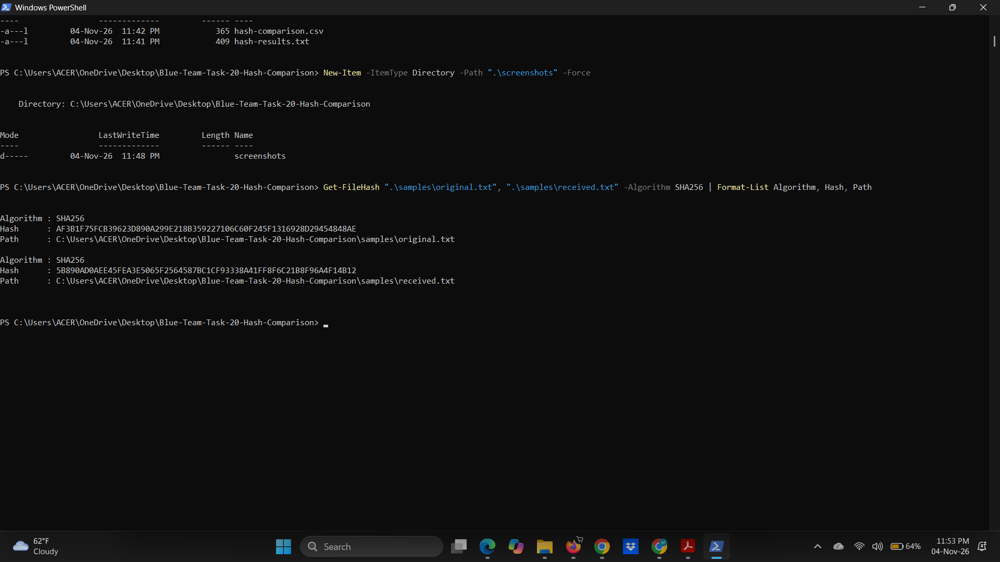
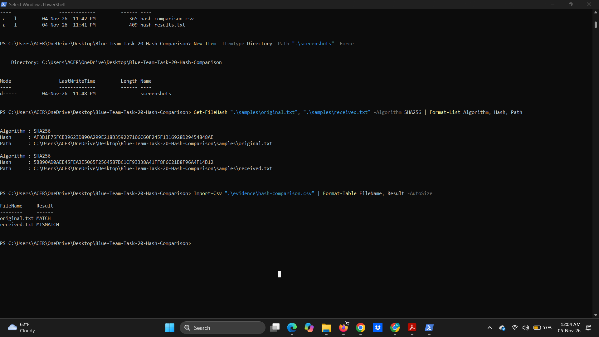

# Blue Team Lab — Task 20: Known-File Hash Comparison

## Overview

This project documents a practical Blue Team file integrity investigation completed as part of the GraySentinel Cyber Defence Lab — Day 1 Practical Mission Bank.

The objective was to calculate and compare SHA-256 hashes of two benign files to determine whether a received file matched a trusted reference.

**Mission:** Task #20 — Known-File Hash Comparison  
**Category:** Email and Threat Intelligence  
**Environment:** Windows / PowerShell  
**Technique:** SHA-256 File Integrity Verification

## Objectives

- Create two benign sample files.
- Calculate their SHA-256 hashes.
- Establish a reference hash from the original file.
- Compare both files against the reference.
- Identify matching and mismatching files.
- Preserve command output and screenshots as evidence.

## Tools Used

- Windows PowerShell
- Get-FileHash
- SHA-256 hashing algorithm
- CSV for evidence documentation

## Lab Setup

Two text files were created in a controlled local environment:

| File | Description |
|---|---|
| `original.txt` | Trusted reference file |
| `received.txt` | Simulated received attachment containing modified text |

Both files were 50 bytes in size, demonstrating that equal file sizes do not necessarily indicate identical contents.

The reference hash was generated locally from `original.txt`; it was not provided by an external source.

## Investigation Procedure

### 1. Calculate SHA-256 Hashes

The following PowerShell command was used:

```powershell
Get-FileHash ".\samples\original.txt", ".\samples\received.txt" -Algorithm SHA256
```

### 2. Compare Hash Values

The hash of `original.txt` was selected as the trusted reference.

Each file's calculated SHA-256 value was compared against that reference.

### 3. Record Findings

The comparison results were exported to a CSV file, and the PowerShell hash output was saved for review.

## Investigation Results

**Reference SHA-256:**

`AF3B1F75FCB39623D890A299E218B359227106C60F245F1316928D29454848AE`

| File | Comparison Result |
|---|---|
| original.txt | MATCH |
| received.txt | MISMATCH |

**Received file SHA-256:**

`5B890AD0AEE45FEA3E5065F2564587BC1CF93338A41FF8F6C21B8F96A4F14B12`

The received file did not match the reference hash, confirming a difference in file contents.

## Evidence Screenshots

### SHA-256 Hash Calculation



### File Hash Comparison



## Evidence Files

- `evidence/hash-results.txt` — Saved SHA-256 command output.
- `evidence/hash-comparison.csv` — File-to-reference comparison table.
- `screenshots/` — Screenshots showing the investigation results.
- `samples/` — Benign files used during the exercise.

## Security Analysis

SHA-256 hashing is useful for file integrity verification because a modification to file contents will generally produce a different hash.

In this investigation, the two files had equal sizes but different SHA-256 values.

The mismatch indicates a content difference, not necessarily malicious activity. The files were deliberately created with different text for this authorized exercise.

## Conclusion

Successfully completed a controlled file integrity verification using Windows PowerShell and SHA-256 hashing.

The investigation demonstrated how a Blue Team analyst can compare a received file against a trusted reference, identify a mismatch, and preserve supporting evidence for review.

**Final Result: Task #20 — Completed.**

---

*GraySentinel Blue Team Day 1 Practical Mission — Authorized Local Lab*